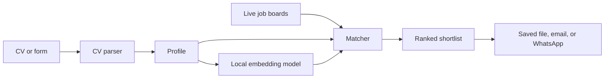

# Job Matchmaker Agent

[](https://www.python.org/)
[](https://gradio.app/)

The agent reads a CV and ranks live job listings by how close they are to that CV. Keyword overlap is only part of the score. A local language model compares the meaning of the résumé with each posting.

Practice listings ship with the project for offline demos. Remotive, Jobicy, Remote OK, Himalayas, and Working Nomads are the live feeds, and they are on by default.

## How it works



1. The CV parser reads a PDF, DOCX, or TXT résumé and fills the profile: name, contact details, headline roles, skills, location, and experience level.
2. The fetcher loads live listings and keeps them in a cache for six hours. The sample board and the local HTML board stay available for offline demos.
3. A local embedding model turns the CV text and each posting into vectors. The matcher blends that meaning score with skills and location.
4. The shortlist is shown in the app. The same text can be saved, emailed, or sent through WhatsApp.

## How a match is scored

When the embedding model is available, the percentage is:

| Part | Weight |
| --- | --- |
| Meaning of the CV compared with the posting | 70% |
| Skills found in the posting | 20% |
| Location | 10% |

If the model is unavailable, the score falls back to skills 50%, job title 25%, and location 25%.

A result of 75% or higher is a strong fit. A lower number is the closest listing the boards had, and it still needs a human look. The live boards contain few exact research roles.

## Project layout

| File | Role |
| --- | --- |
| `app.py` | Gradio interface |
| `job_matchmaker/cv_parser.py` | Reads PDF, DOCX, and TXT résumés |
| `job_matchmaker/fetcher.py` | Live boards, the sample board, and the local HTML board |
| `job_matchmaker/semantic.py` | Local meaning comparison |
| `job_matchmaker/matcher.py` | Turns those signals into a ranked score |
| `job_matchmaker/render.py` | Job cards and the notification text |
| `job_matchmaker/notifier.py` | Saved file, SMTP email, and Twilio WhatsApp |
| `job_matchmaker/store.py` | Saved searches for the daily run |
| `run_saved.py` | Runs the saved searches once, or every day |
| `tests/` | Parser, ranking, and notification checks |

## Run it

```powershell
python -m venv .venv
.\.venv\Scripts\python -m pip install -r requirements.txt
.\.venv\Scripts\python app.py
```

Open http://127.0.0.1:7860

Upload a PDF or DOCX résumé and click **Match jobs to this CV**. The form fills with the name, roles, skills, and location read from the file, and the shortlist appears beside it. Edit any field and click **Find matching jobs** to search again. The example buttons still load three practice profiles.

## Check the matcher

```powershell
.\.venv\Scripts\python -m job_matchmaker.demo
.\.venv\Scripts\python -m unittest discover -s tests -v
```

## Email and WhatsApp

```powershell
copy .env.example .env
```

Email uses `smtplib`. For Gmail, use an app password with `SMTP_HOST=smtp.gmail.com` and `SMTP_PORT=587`.

WhatsApp uses a Twilio sandbox number. The recipient has to join that sandbox, and `TWILIO_WHATSAPP_FROM` looks like `whatsapp:+14155238886`.

If those values are empty, the shortlist is still saved under `notifications/`.

## Run it every day

Turn on **Save this search for the daily run** and search once. Then:

```powershell
.\.venv\Scripts\python run_saved.py
.\.venv\Scripts\python run_saved.py --loop
```

`--loop` uses the `schedule` package and repeats at `RUN_AT` (09:00 by default) while the window stays open. Windows Task Scheduler, cron, or cron-job.org can call `run_saved.py` instead.

## Job boards

LinkedIn, Indeed, and Glassdoor do not publish a keyless feed, so this agent does not scrape them. The live boards are Remotive, Jobicy, Remote OK, Himalayas, and Working Nomads. Each live card links back to the original posting. Results are cached for six hours.

Sample board and local HTML board listings are fictional. Do not apply to the example.com links.
